# RotinApp - Trabalho 4

Continuação do RotinApp (Kotlin + Jetpack Compose). No Trabalho 3 eu coloquei o banco Room no app. Neste trabalho o app continua fazendo as mesmas coisas, mas reorganizei o código em camadas (Model, Repository, ViewModel e View), usando Flow, UiState e ViewModelFactory. Usei como base o exemplo de Filmes em MVVM (banco-03-mvvm) visto em aula.

## Como rodar

1. Clonar o repositório (`git clone https://github.com/caioraduy/RotinaAppTrab3.git`) ou baixar o zip.
2. No Android Studio, ir em File > Open e abrir a pasta do projeto.
3. Esperar o Gradle Sync terminar.
4. Criar um emulador em Tools > Device Manager (se ainda não tiver).
5. Selecionar "app" e o emulador e clicar em Run.

Se aparecer "Add Configuration" no lugar de "app": Run > Edit Configurations > + > Android App, escolher o módulo `My_Application.app` e dar OK.
Se der erro de JDK no Sync: File > Settings > Build Tools > Gradle e escolher o JDK 21.

## Organização do projeto

```text
app/src/main/java/com/example/myapplication/
├── MainActivity.kt          cria o banco e os repositories e chama a navegação
├── data/
│   ├── local/               Room: entidades, DAOs e AppDatabase
│   │   ├── Rotina.kt, Atividade.kt, Meta.kt, Perfil.kt
│   │   ├── RotinaDAO.kt, AtividadeDAO.kt, MetaDAO.kt, PerfilDAO.kt
│   │   ├── AppDatabase.kt
│   │   └── Historico.kt
│   └── repository/
│       ├── RotinaRepository.kt, AtividadeRepository.kt
│       └── MetaRepository.kt, PerfilRepository.kt
├── viewmodel/               um UiState, um ViewModel e uma Factory para cada tela
│   ├── ListaRotinas..., CriacaoRotina..., DetalhesRotina...
│   ├── Metas..., Perfil..., Historico...
│   └── Desempenho..., Progresso...
└── ui/                      telas
    ├── AppNavegacao.kt, RotaAbas.kt
    ├── TelaListaRotina.kt, TelaCriacao.kt, TelaRotina.kt
    ├── TelaMetas.kt, TelaPerfil.kt, TelaPerfilCont.kt
    ├── TelaHistorico.kt, TelaDesempenho.kt, Progresso.kt
    └── theme/
```

O caminho dos dados ficou assim:

Tela -> ViewModel -> Repository -> DAO -> banco

e a volta é pelo Flow: o banco muda, o Room avisa o Repository, o ViewModel atualiza o uiState e a tela se redesenha.

## Documentação

### 1. Como estava o projeto no Trabalho 3, e o que mudou?

No Trabalho 3 estava quase tudo no mesmo pacote: telas, DAOs, banco e alguns ViewModels misturados. As entidades (Rotina, Atividade, Meta e Perfil) estavam dentro de `ui/theme`, o que não fazia sentido. Cada tela abria o banco, pegava o DAO e fazia as operações com `CoroutineScope(Dispatchers.IO).launch`. As listas eram carregadas uma vez no `LaunchedEffect(Unit)` e, depois de inserir ou apagar, eu tinha que buscar de novo na mão. E cada tela tinha várias variáveis `remember` soltas.

O que mudei:

- separei o código nos pacotes `data/local`, `data/repository`, `viewmodel` e `ui`;
- criei um repository para cada entidade, e agora só ele chama o DAO;
- o `buscarTodos()` dos DAOs agora retorna `Flow<List<...>>`, então as listas atualizam sozinhas;
- cada tela ganhou um ViewModel com um UiState (`_uiState` privado e `uiState` público) e uma Factory;
- as telas só leem o `uiState` e chamam funções do ViewModel (`onSave`, `onEdit`, `onDelete`...), sem DAO e sem coroutine;
- apaguei o `OperacoesBanco.kt`: o acesso ao DAO foi para os repositories e o try/catch com `Log.e` foi para os ViewModels;
- a MainActivity cria o banco e os repositories, e o `AppNavegacao` cria o ViewModel de cada tela com a Factory;
- passei as dependências para o `libs.versions.toml`.

Antes, na tela de metas:

```kotlin
val db = AppDatabase.getDatabase(context)
val metaDAO = db.metaDAO()

LaunchedEffect(Unit) {
    CoroutineScope(Dispatchers.IO).launch {
        metas = buscarMetas(metaDAO)
    }
}
```

Agora:

```kotlin
val uiState by viewModel.uiState.collectAsStateWithLifecycle()
...
items(uiState.listaDeMetas) { meta -> CardMeta(meta, onDelete = { viewModel.onDelete(meta) }, ...) }
```

### 2. Como dividi os pacotes?

- `data/local`: tudo do Room, igual ao Trabalho 3 (as 4 entidades, os 4 DAOs e o AppDatabase). Coloquei o `Historico.kt` aqui também porque é um modelo de dados.
- `data/repository`: os 4 repositories. Cada um recebe seu DAO no construtor.
- `viewmodel`: para cada tela que usa dados tem o UiState, o ViewModel e a Factory. São 8 telas, então ficaram 8 de cada.
- `ui`: as telas, a navegação e o tema (o `theme` agora só tem Color, Theme e Type).

A MainActivity ficou fora desses pacotes. Ela cria os repositories e passa para o `AppNavegacao`, que cria o ViewModel de cada tela:

```kotlin
composable(RotaAbas.TelaMetas) {
    TelaMetas(
        navController = navController,
        viewModel = viewModel(factory = MetasViewModelFactory(metaRepository))
    )
}
```

Assim a tela só recebe o ViewModel e não sabe nada do banco. O `PerfilViewModel` é criado uma vez só porque as duas telas de perfil usam o mesmo.

### 3. Por que o Repository existe?

Antes cada tela falava direto com o DAO. Se eu mudasse a forma de buscar os dados, ia ter que mexer em várias telas. Agora o repository é o único lugar que acessa os dados: o ViewModel pede para ele e ele repassa para o DAO. Se um dia os dados vierem de uma API, por exemplo, só o repository muda.

```kotlin
class MetaRepository(private val metaDAO: MetaDAO) {

    fun buscarTodos(): Flow<List<Meta>> {
        return metaDAO.buscarTodos()
    }

    suspend fun inserir(meta: Meta) {
        metaDAO.inserir(meta)
    }
    // atualizar e deletar seguem o mesmo jeito
}
```

Junto com isso o DAO passou a usar Flow, então não preciso mais buscar a lista de novo depois de salvar ou apagar:

```kotlin
@Query("SELECT * FROM metas")
fun buscarTodos() : Flow<List<Meta>>
```

### 4. O que tem no UiState de cada tela?

Coloquei no UiState tudo que a tela precisa para aparecer: as listas do banco, o que está escrito nos campos, se algum diálogo está aberto e as mensagens.

- `ListaRotinasUiState`: `listaDeRotinas` e `rotinaParaExcluir` (a rotina que está no diálogo de excluir).
- `CriacaoRotinaUiState`: os campos do formulário (nome, início, fim, nome e duração da atividade), a lista de atividades antes de salvar, `idRotinaEditando` (para saber se é nova ou edição), `salvando` (desativa o botão), `rotinaSalva` (para a tela voltar) e `mensagem` (texto do Toast).
- `DetalhesRotinaUiState`: `carregando`, a `rotina` buscada pelo id, as `atividades` dela e `atividadesConcluidas` (as que estão marcadas).
- `MetasUiState`: `listaDeMetas`, `totalMetas` e `metasConcluidas` (para o "X de Y"), `mostrarDialogo`, `metaEmEdicao`, `nome`, `descricao` e `metaSelecionada`. O texto "Adicionar"/"Atualizar" é calculado a partir do `metaEmEdicao`, igual ao `textoBotao` do exemplo de Filmes.
- `PerfilUiState`: `perfil`, `possuiCadastro`, `nome`, `email` e `perfilSalvo`.
- `HistoricoUiState`: as listas de rotinas e metas e os totais.
- `DesempenhoUiState`: nível, XP, quantidade de rotinas e atividades, tempo total, média e a rotina mais longa. As contas são feitas no ViewModel.
- `ProgressoUiState`: nível e XP para o card de progresso (antes essa conta era feita na tela).

Todos os ViewModels seguem o mesmo jeito:

```kotlin
class MetasViewModel(private val metaRepository: MetaRepository) : ViewModel() {

    private val _uiState = MutableStateFlow(MetasUiState())
    val uiState: StateFlow<MetasUiState> = _uiState.asStateFlow()

    init {
        viewModelScope.launch {
            metaRepository.buscarTodos().collect { lista ->
                _uiState.update { it.copy(listaDeMetas = lista) }
            }
        }
    }

    fun onDelete(meta: Meta) {
        viewModelScope.launch {
            try {
                metaRepository.deletar(meta)
            } catch (e: Exception) {
                Log.e("Erro ao deletar meta", "Msg: ${e.message}")
            }
        }
    }
}
```

### 5. Alguma coisa quebrou durante a reorganização?

No final ficou tudo funcionando: testei adicionar, listar, editar, remover, fechar e abrir o app de novo. Mas no meio do caminho algumas coisas quebraram:

- quando tirei as entidades de `ui/theme`, vários arquivos pararam de compilar por causa dos imports. Fui corrigindo arquivo por arquivo;
- o `OperacoesBanco.kt` parou de funcionar porque o `buscarTodos()` deixou de ser suspend. Acabei apagando ele e passando as funções para os repositories e ViewModels;
- depois de salvar uma rotina, a tela mostrava o Toast e voltava usando `withContext(Dispatchers.Main)`, que não podia mais ficar na tela. Resolvi colocando `mensagem` e `rotinaSalva` no UiState, e a tela reage com `LaunchedEffect`;
- ao voltar da edição para a tela de detalhes, ela podia mostrar o nome antigo, porque o ViewModel dos detalhes continua vivo. Fiz o `buscarPorId` também retornar Flow, e aí ela atualiza sozinha;
- no perfil, como as duas telas usam o mesmo ViewModel, o `perfilSalvo` ficava true e a tela de cadastro fechava sozinha na próxima vez. Coloquei para ele voltar a false quando abre o cadastro e depois de voltar;
- quando mudei os nomes das funções para o padrão `onSave`, `onEdit`, `onDelete` (igual ao exemplo de Filmes), tive que trocar as chamadas nas telas também;
- apareceram avisos no build de ícones antigos (`Icons.Filled.ArrowBack` e outros) e do Room sobre exportar o schema. Troquei pelos ícones `AutoMirrored` e coloquei `exportSchema = false`.

Fui achando esses problemas compilando no Android Studio (aba Build) e testando as telas uma por uma.

Prints do app funcionando igual ao Trabalho 3:

Rotinas (nova rotina, lista e detalhes):

<p>
  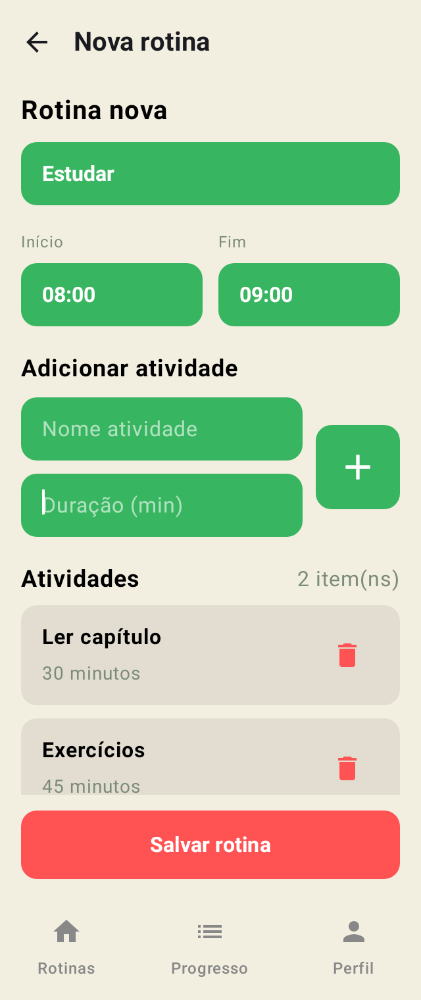
  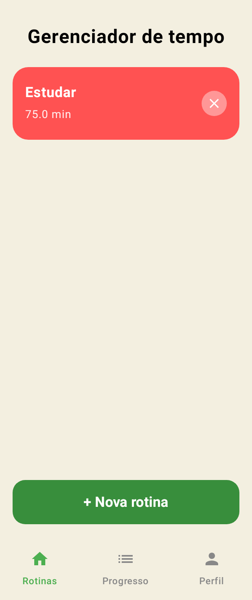
  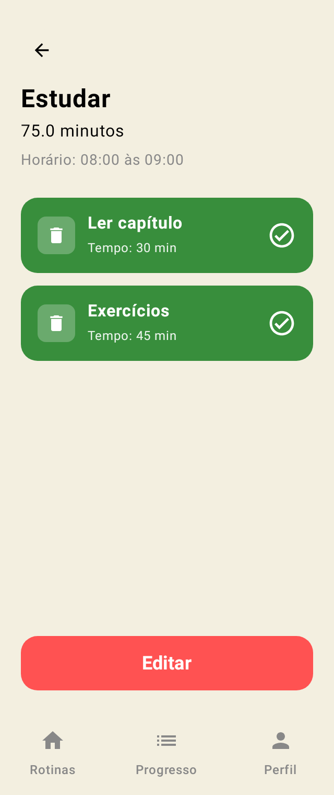
</p>

Editando a rotina e os detalhes já atualizados:

<p>
  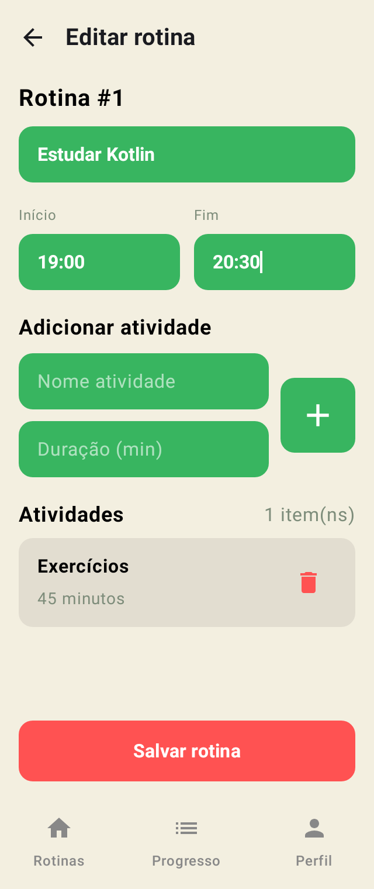
  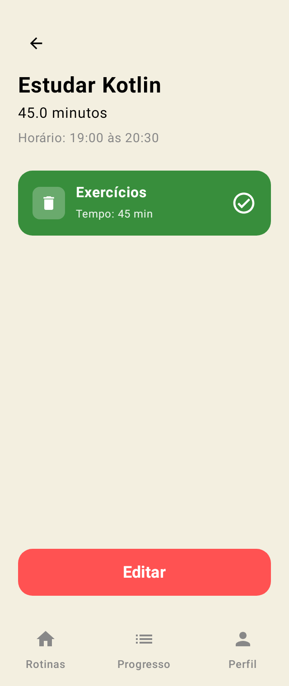
</p>

Metas, perfil, progresso, histórico e desempenho:

<p>
  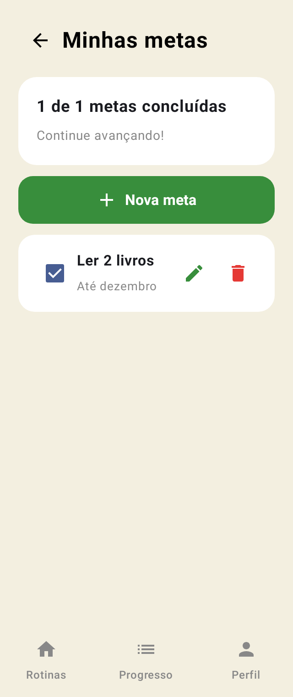
  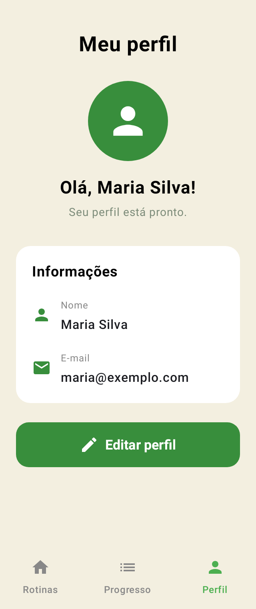
  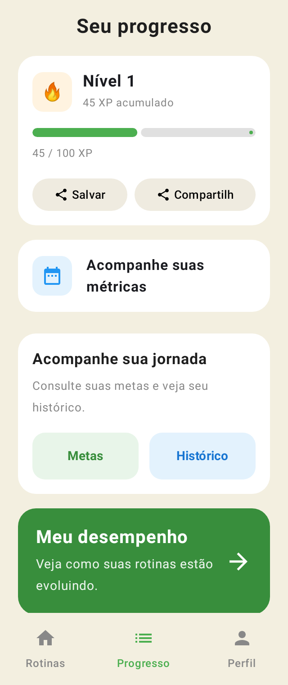
  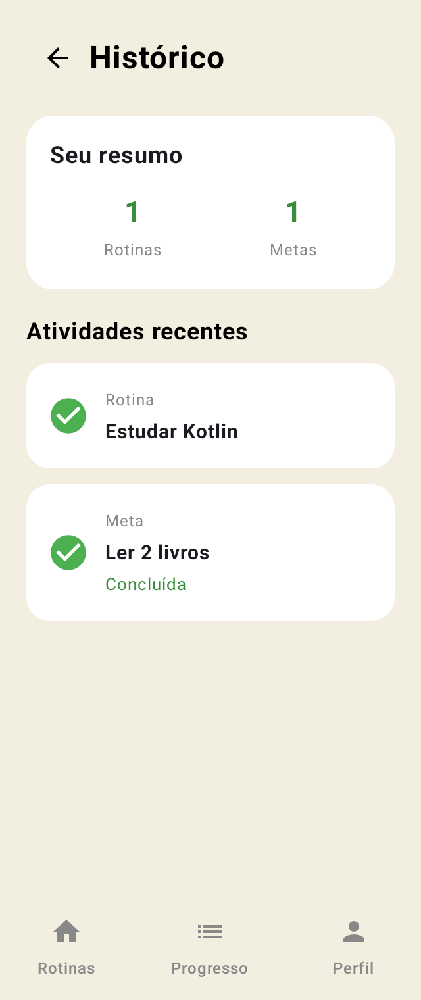
  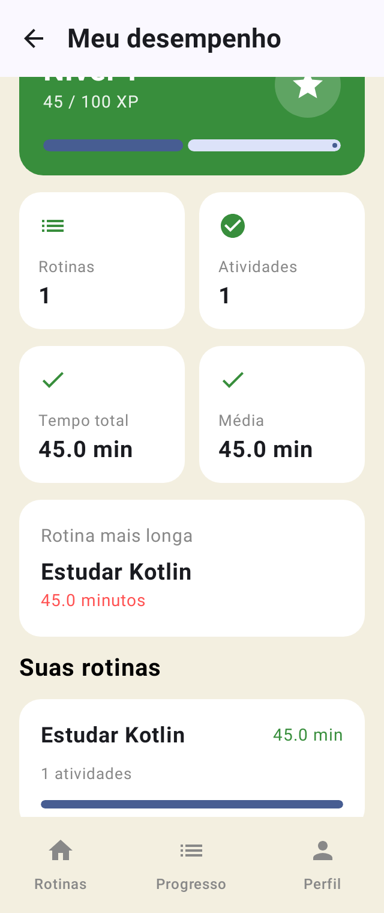
</p>

Depois de fechar e abrir o app (os dados continuam) e removendo a rotina:

<p>
  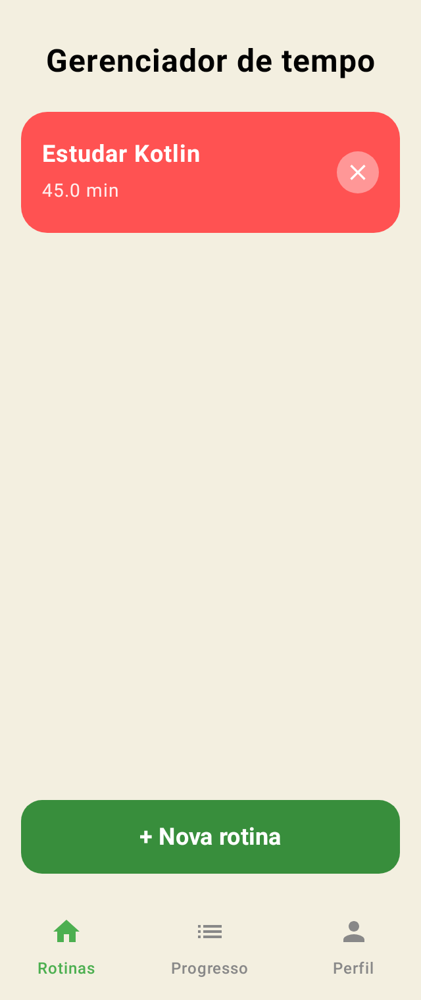
  
  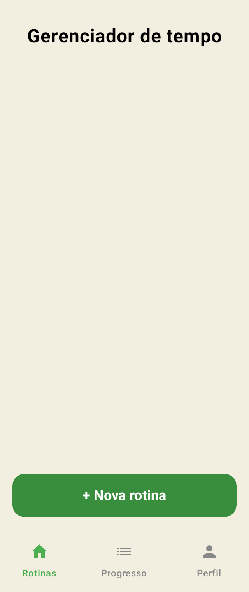
</p>

### 6. Algum integrante do trio teve dificuldade?

Não se aplica, fiz o trabalho sozinho.

## Checklist

- [x] Código dividido em `ui`, `data` (`data/local`), `data.repository` e `viewmodel`
- [x] Um repository por entidade, e só ele fala com o DAO
- [x] `buscarTodos()` dos DAOs retorna `Flow<List<...>>`
- [x] 8 ViewModels, cada um com seu UiState
- [x] `_uiState` privado e `uiState` público (StateFlow) em todos
- [x] Factories passando o repository para o ViewModel
- [x] Telas sem DAO, `CoroutineScope` ou `Dispatchers.IO`
- [x] App continua fazendo tudo do Trabalho 3
- [x] Documentação com prints

## Tecnologias

Kotlin, Jetpack Compose, Navigation Compose, Room 2.8.5 (KSP), Coroutines, Flow/StateFlow, ViewModel e Android Studio.

## Referências

- Exemplo de aula: `banco-03-mvvm/versao_final_mvvm` (CRUD de Filmes em MVVM) e slides da Aula 21 a 23 - MVVM
- https://developer.android.com/topic/architecture/data-layer
- https://developer.android.com/topic/architecture/ui-layer/state-production
- https://developer.android.com/topic/libraries/architecture/viewmodel/viewmodel-factories
- https://developer.android.com/training/data-storage/room/async-queries

Universidade Positivo - Desenvolvimento de Aplicativos Móveis
