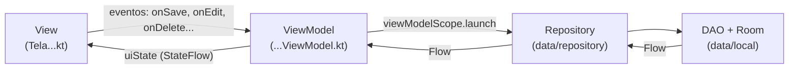

# 🌱 RotinApp — Trabalho 4: organização em camadas

App Android feito em **Kotlin com Jetpack Compose**, continuação do Trabalho 3.

O app faz **exatamente o mesmo** que no Trabalho 3 (rotinas, atividades, metas e perfil salvos no banco **Room**). O que mudou foi a **organização do código**: agora ele está separado em camadas — **Model, Repository, ViewModel e View** — com `Flow`, `UiState` e `ViewModelFactory`, seguindo o exemplo **banco-03-mvvm** (CRUD de Filmes em MVVM) do professor.

> 📚 Projeto acadêmico individual — Universidade Positivo — Desenvolvimento de Aplicativos Móveis

🎥 **Vídeo do app funcionando:** [assistir no YouTube](https://youtu.be/iRxCBf9muUg)

📄 Documentação do Trabalho 3 (Room): [docs/trabalho3.md](docs/trabalho3.md)

---

## ▶️ Como rodar o projeto

1. Baixar o projeto (`git clone https://github.com/caioraduy/RotinaAppTrab3.git` ou baixar o `.zip` e descompactar).
2. No Android Studio: **File > Open** e escolher a pasta do projeto (a que tem o `settings.gradle.kts`).
3. Esperar o **Gradle Sync** terminar (barra no rodapé). Na primeira vez precisa de internet.
4. Criar um emulador: **Tools > Device Manager** → **+** → escolher um celular (ex.: Pixel) → escolher uma versão do Android → **Finish**.
5. Na barra de cima, escolher **app** e o emulador, e clicar em **Run ▶**.

### ⚙️ Se não conseguir rodar

* **Aparece "Add Configuration…" no lugar de "app":** **Run > Edit Configurations** → **+** → **Android App** → Module: `My_Application.app` → **OK**.
* **Erro de Java/JDK no Sync:** **File > Settings > Build, Execution, Deployment > Build Tools > Gradle** → **Gradle JDK** → escolher um **JDK 21**.
* **Falta plataforma/SDK:** clicar no link que o Android Studio mostra para instalar e sincronizar de novo.

---

## 🧱 As camadas



| Camada | Onde está | O que faz |
|---|---|---|
| **Model** | `data/local/` | `@Entity` (Rotina, Atividade, Meta, Perfil), `@Dao` e `AppDatabase` |
| **Repository** | `data/repository/` | única porta de entrada dos dados; só repassa para o DAO |
| **ViewModel** | `viewmodel/` (`...ViewModel`, `...UiState`, `...ViewModelFactory`) | guarda o `UiState` da tela e chama o Repository |
| **View** | `ui/` (`Tela...kt`) | telas `@Composable`: só leem o `uiState` e chamam o ViewModel |

Organização igual ao exemplo do professor (`data/local`, `data/repository`, mesmo padrão de UiState/ViewModel/Factory), com os ViewModels num pacote `viewmodel` próprio, como pede o checklist do enunciado:

```text
app/src/main/java/com/example/myapplication/
├── MainActivity.kt                 → cria o banco e os Repositories e chama a navegação
├── data/
│   ├── local/                      → MODEL (Room)
│   │   ├── Rotina.kt, Atividade.kt, Meta.kt, Perfil.kt   (@Entity)
│   │   ├── RotinaDAO.kt, AtividadeDAO.kt, MetaDAO.kt, PerfilDAO.kt (@Dao)
│   │   ├── AppDatabase.kt          (@Database — Singleton)
│   │   └── Historico.kt            (histórico em memória, igual ao T3)
│   └── repository/                 → REPOSITORY
│       ├── RotinaRepository.kt, AtividadeRepository.kt
│       └── MetaRepository.kt, PerfilRepository.kt
├── viewmodel/                      → VIEWMODEL (para cada tela: UiState + ViewModel + Factory)
│   ├── ListaRotinasUiState.kt, ListaRotinasViewModel.kt, ListaRotinasViewModelFactory.kt
│   ├── CriacaoRotinaUiState.kt, CriacaoRotinaViewModel.kt, CriacaoRotinaViewModelFactory.kt
│   ├── DetalhesRotinaUiState.kt, DetalhesRotinaViewModel.kt, DetalhesRotinaViewModelFactory.kt
│   ├── MetasUiState.kt, MetasViewModel.kt, MetasViewModelFactory.kt
│   ├── PerfilUiState.kt, PerfilViewModel.kt, PerfilViewModelFactory.kt
│   ├── HistoricoUiState.kt, HistoricoViewModel.kt, HistoricoViewModelFactory.kt
│   ├── DesempenhoUiState.kt, DesempenhoViewModel.kt, DesempenhoViewModelFactory.kt
│   └── ProgressoUiState.kt, ProgressoViewModel.kt, ProgressoViewModelFactory.kt
└── ui/                             → VIEW
    ├── AppNavegacao.kt             (NavHost: cria cada ViewModel com a sua Factory)
    ├── RotaAbas.kt                 (nomes das rotas)
    ├── TelaListaRotina.kt, TelaCriacao.kt, TelaRotina.kt
    ├── TelaMetas.kt, TelaPerfil.kt, TelaPerfilCont.kt
    ├── TelaHistorico.kt, TelaDesempenho.kt, Progresso.kt
    └── theme/                      (Color.kt, Theme.kt, Type.kt)
```

---

# 📝 Documentação do processo e das decisões

## 1. Como estava o projeto no Trabalho 3, e o que mudou na reorganização?

**Como estava:**

* Quase todos os arquivos ficavam juntos no pacote principal: telas, DAOs, banco e ViewModels.
* As `@Entity` estavam dentro de `ui/theme`, que deveria ser só do tema.
* Cada **tela** pegava o DAO (`AppDatabase.getDatabase(context).rotinaDAO()`) e acessava o banco com `CoroutineScope(Dispatchers.IO).launch`.
* As listas eram buscadas uma vez num `LaunchedEffect(Unit)` e, depois de inserir ou remover, a tela precisava **buscar de novo na mão**.
* O estado das telas ficava em várias variáveis `remember { mutableStateOf(...) }` soltas.

**O que mudou:**

* O código foi separado nos pacotes `data/local` (Room), `data/repository`, `viewmodel` e `ui`, no padrão do exemplo do professor.
* Criei **1 Repository por Entity**. Agora **só o Repository fala com o DAO**.
* O `buscarTodos()` de todos os DAOs passou a retornar **`Flow<List<...>>`** (não é mais `suspend`). Com isso, as listas **atualizam sozinhas** quando o banco muda.
* Cada tela ganhou um **ViewModel** com um **`UiState`** (`_uiState` privado + `uiState` público) e uma **Factory**.
* As telas agora só fazem duas coisas: **ler o `uiState`** (`collectAsStateWithLifecycle()`) e **chamar métodos do ViewModel**. Não têm mais DAO, `CoroutineScope` nem `Dispatchers.IO`.
* O `OperacoesBanco.kt` foi removido (igual no exemplo do professor): a parte de acessar o DAO foi para o Repository, e o `try/catch` com `Log.e` foi para o ViewModel.
* As funções do ViewModel seguem o padrão **`onEvento`** do exemplo: `onSave`, `onEdit`, `onDelete`, `onNomeChange`...
* A `MainActivity` cria o banco e os Repositories e passa para a navegação; o `AppNavegacao` cria o ViewModel de cada tela com a Factory. Assim, **nenhuma tela conhece o banco nem o DAO**.
* Também deixei o projeto no formato padrão do Android Studio: dependências no `gradle/libs.versions.toml` e `.gitignore` padrão.

**Antes (Trabalho 3) — dentro da tela:**

```kotlin
val db = AppDatabase.getDatabase(context)
val metaDAO = db.metaDAO()

LaunchedEffect(Unit) {
    CoroutineScope(Dispatchers.IO).launch {
        metas = buscarMetas(metaDAO)
    }
}
```

**Depois (Trabalho 4) — a tela só observa:**

```kotlin
val uiState by viewModel.uiState.collectAsStateWithLifecycle()
// ...
items(uiState.listaDeMetas) { meta -> CardMeta(meta, onDelete = { viewModel.onDelete(meta) }, ...) }
```

---

## 2. Como decidi dividir os pacotes — o que foi para `ui`, `data`, `data.repository` e `viewmodel`?

Segui o padrão do exemplo **banco-03-mvvm** do professor (CRUD de Filmes), com os ViewModels num pacote `viewmodel` próprio, como pede o enunciado:

* **`data.local`** (o pacote `data` do enunciado) → tudo do Room, do jeito que já existia no Trabalho 3: as 4 `@Entity`, os 4 `@Dao` e o `AppDatabase`. O `Historico.kt` (histórico em memória) também foi para cá.
* **`data.repository`** → os 4 Repositories novos (`RotinaRepository`, `AtividadeRepository`, `MetaRepository`, `PerfilRepository`). Cada um recebe o seu DAO no construtor.
* **`viewmodel`** → para cada tela, 3 arquivos: `UiState`, `ViewModel` e `ViewModelFactory` (como `FilmesUiState`, `FilmesViewModel` e `FilmesViewModelFactory` do professor). São 8 telas que usam dados, então são 8 de cada.
* **`ui`** → as telas `@Composable`, a navegação (`AppNavegacao.kt` e `RotaAbas.kt`) e o `theme` (que agora tem só Color, Theme e Type).
* **`MainActivity.kt`** ficou no pacote principal: cria o banco e os Repositories e chama a navegação.

O ViewModel de cada tela é criado no `AppNavegacao` com a Factory (`viewModel(factory = ...)`), recebendo o Repository que a `MainActivity` criou. A tela só recebe o ViewModel pronto — ela não cita `AppDatabase`, DAO nem Repository:

```kotlin
// AppNavegacao.kt
composable(RotaAbas.TelaMetas) {
    TelaMetas(
        navController = navController,
        viewModel = viewModel(factory = MetasViewModelFactory(metaRepository))
    )
}

// TelaMetas.kt
@Composable
fun TelaMetas(navController: NavHostController, viewModel: MetasViewModel) {
    val uiState by viewModel.uiState.collectAsStateWithLifecycle()
    // ...
}
```

O `PerfilViewModel` é criado uma vez só no `AppNavegacao`, porque as duas telas de perfil usam o **mesmo** ViewModel.

---

## 3. Por que o Repository existe — o que ele resolve que não existia antes?

Antes, **cada tela falava direto com o DAO**. Se a forma de buscar os dados mudasse, eu teria que mexer em várias telas.

Agora o Repository é a **única porta de entrada para os dados**. O ViewModel pede para o Repository, e o Repository repassa para o DAO. Se um dia as rotinas vierem de uma **API** em vez do Room, **só o Repository muda** — o ViewModel e a tela continuam iguais.

```kotlin
class MetaRepository(private val metaDAO: MetaDAO) {

    fun buscarTodos(): Flow<List<Meta>> {
        return metaDAO.buscarTodos()
    }

    suspend fun inserir(meta: Meta) {
        metaDAO.inserir(meta)
    }
    // atualizar(...) e deletar(...) do mesmo jeito
}
```

E com o **Flow** no DAO, não preciso mais buscar a lista de novo depois de inserir ou remover: o Room manda a lista nova sozinho.

```kotlin
@Query("SELECT * FROM metas")
fun buscarTodos() : Flow<List<Meta>>   // não é mais suspend
```

---

## 4. O que tem dentro do UiState de cada tela, e por que escolhi esses campos?

Escolhi colocar no `UiState` **tudo o que a tela precisa para se desenhar**: as listas que vêm do banco, os textos dos formulários, o que está aberto (diálogos) e os avisos. Assim a tela não tem mais variáveis `remember` soltas.

| Tela | UiState | Campos | Por quê |
|---|---|---|---|
| Lista de rotinas | `ListaRotinasUiState` | `listaDeRotinas`, `rotinaParaExcluir` | a lista do banco e qual rotina está no diálogo "Excluir rotina?" |
| Nova / editar rotina | `CriacaoRotinaUiState` | `idRotinaEditando`, `nomeRotina`, `inicio`, `fim`, `nomeAtividade`, `duracaoAtividade`, `atividades`, `salvando`, `rotinaSalva`, `mensagem` | os campos do formulário, o rascunho das atividades, se está salvando (desabilita o botão), se já salvou (a tela volta) e o texto do Toast |
| Detalhes da rotina | `DetalhesRotinaUiState` | `carregando`, `rotina`, `atividades`, `atividadesConcluidas` | mostrar "Carregando...", a rotina buscada pelo id, as atividades dela e quais estão marcadas com ✓ |
| Metas | `MetasUiState` | `listaDeMetas`, `totalMetas`, `metasConcluidas`, `mostrarDialogo`, `metaEmEdicao`, `nome`, `descricao`, `metaSelecionada` + calculados `tituloDialogo` e `textoBotao` | a lista, o resumo "X de Y", o diálogo de adicionar/editar e o de detalhes. Igual ao `textoBotao` do `FilmesUiState`: o texto "Adicionar"/"Atualizar" vem do `metaEmEdicao`, sem um `estouEditando` separado |
| Perfil / cadastro | `PerfilUiState` | `perfil`, `possuiCadastro`, `nome`, `email`, `perfilSalvo` | o perfil salvo, se mostra "Olá, nome!", os campos do formulário e se já salvou |
| Histórico | `HistoricoUiState` | `rotinas`, `metas`, `totalRotinas`, `totalMetas` | o card "Seu resumo" e a lista de atividades recentes |
| Desempenho | `DesempenhoUiState` | `nivel`, `xpNoNivel`, `progressoNivel`, `quantidadeRotinas`, `quantidadeAtividades`, `tempoTotal`, `mediaTempoRotina`, `maiorRotina`, `rotinas`, `atividadesPorRotina`, `percentualPorRotina` | todos os números já chegam calculados pelo ViewModel; a tela só mostra |
| Progresso | `ProgressoUiState` | `nivel`, `xp`, `xpNoNivel`, `progresso` | o card do nível (antes a conta do XP era feita na tela) |

Exemplo do padrão usado em todos os ViewModels:

```kotlin
class MetasViewModel(private val metaRepository: MetaRepository) : ViewModel() {

    private val _uiState = MutableStateFlow(MetasUiState())          // só o ViewModel altera
    val uiState: StateFlow<MetasUiState> = _uiState.asStateFlow()    // a tela só lê

    init {
        viewModelScope.launch {
            metaRepository.buscarTodos().collect { lista ->
                _uiState.update { it.copy(listaDeMetas = lista) }
            }
        }
    }

    fun onDelete(meta: Meta) {
        viewModelScope.launch {
            try {
                metaRepository.deletar(meta)
            } catch (e: Exception) {
                Log.e("Erro ao deletar meta", "Msg: ${e.message}")
            }
        }
    }
}
```

---

## 5. Alguma funcionalidade quebrou durante a reorganização? Como encontrei e corrigi?

No final **nada ficou quebrado**: testei o fluxo completo do Trabalho 3 (adicionar, listar, editar, remover, fechar e reabrir o app) e tudo continua funcionando. Mas no caminho estes pontos quebraram ou precisaram mudar:

* **Ao mover as Entities de `ui/theme` para `data`, vários arquivos pararam de compilar** (os `import ...ui.theme.Rotina` não existiam mais). → Corrigi os imports em todos os arquivos.
* **O `OperacoesBanco.kt` parou de funcionar**, porque o `buscarTodos()` deixou de ser `suspend` e passou a retornar `Flow`. → Removi o arquivo: o acesso ao DAO foi para os Repositories, e o `try/catch` com `Log.e` foi para os ViewModels.
* **O Toast e o `popBackStack()` depois de salvar** ficavam dentro de `withContext(Dispatchers.Main)` na tela, o que não pode mais existir. → O ViewModel agora coloca `mensagem` e `rotinaSalva` no `UiState`, e a tela reage com `LaunchedEffect` (mostra o Toast e volta).
* **Voltar da edição para os Detalhes**: o ViewModel dos Detalhes continua vivo enquanto a tela está na pilha, então se ele buscasse a rotina só uma vez, ia mostrar o nome antigo. → O `buscarPorId` também passou a retornar `Flow`, e os Detalhes atualizam sozinhos.
* **O cadastro de perfil**: como o `PerfilViewModel` é o mesmo para as duas telas de perfil, o aviso `perfilSalvo` precisava voltar para `false`, senão a tela de cadastro fecharia sozinha na próxima vez. → Criei `onPerfilSalvoMostrado()` e `onEditarPerfil()`, que zeram esse aviso.
* **Mudança para o padrão do professor**: quando os arquivos foram para `data/local` e `viewmodel`, todos os `import` antigos (`...data.Rotina`, `...ui.theme.Rotina`) pararam de compilar, e as chamadas na tela mudaram de nome (ex.: `viewModel.salvarMeta()` → `viewModel.onSave()`). → Corrigi os imports e os nomes, compilei de novo e repeti o teste completo.
* **Avisos no build**: ícones antigos (`Icons.Filled.ArrowBack`, `List`, `ArrowForward`) e um aviso do Room sobre exportar o esquema. → Troquei pelos ícones `AutoMirrored` e coloquei `exportSchema = false` no `AppDatabase`.

**Como encontrei:** compilando no Android Studio (erros e avisos na aba **Build**) e testando cada tela de novo, como na lista abaixo.

### 🖼️ O app funcionando igual ao Trabalho 3

> Os prints foram gerados por um teste automático que roda o app de verdade num Android simulado no computador.

**Rotinas: adicionar, listar, detalhes (busca pelo id):**

<p>
  
  
  
</p>

**Editar rotina (os Detalhes atualizam sozinhos pelo Flow):**

<p>
  
  
</p>

**Metas, perfil, progresso, histórico e desempenho:**

<p>
  
  
  
  
  
</p>

**Depois de fechar e abrir o app de novo (continua persistindo ✅) e removendo a rotina:**

<p>
  
  
  
</p>

---

## 6. Algum integrante do trio teve dificuldade em algum ponto? Como resolveram?

Não se aplica: o trabalho foi feito **individualmente**.

---

# ✅ Checklist do enunciado

| Item | Onde está |
|---|---|
| Código dividido em `ui`, `data`, `data.repository`, `viewmodel` | `ui/`, `data/local/`, `data/repository/`, `viewmodel/` |
| 1 Repository por Entity, e só ele fala com o DAO | `data/repository/` (4 Repositories) |
| `buscarTodos()` do DAO retorna `Flow<List<...>>` | `RotinaDAO`, `AtividadeDAO`, `MetaDAO`, `PerfilDAO` |
| No mínimo 2 ViewModels, cada um com seu UiState | 8 ViewModels + 8 UiStates em `viewmodel/` |
| `_uiState` privado + `uiState` público (`StateFlow`) | todos os ViewModels |
| ViewModelFactory injetando o Repository | 8 Factories em `viewmodel/`, usadas em `ui/AppNavegacao.kt` com `viewModel(factory = ...)` |
| Telas sem DAO, `CoroutineScope` ou `Dispatchers.IO` | todas as telas em `ui/` (o banco e os Repositories são criados na `MainActivity`) |
| App continua fazendo tudo do Trabalho 3 | item 5 (prints) |
| Documentação com prints/vídeo | este README |

---

## 🛠️ Tecnologias

Kotlin, Jetpack Compose, Navigation Compose, **Room 2.8.5** (KSP), Coroutines, **Flow / StateFlow**, **ViewModel + ViewModelProvider.Factory**, `collectAsStateWithLifecycle`, Git e Android Studio.

## 📚 Referências

* Exemplo do professor: `Aula Banco/banco-03-mvvm/versao_final_mvvm` (CRUD de Filmes em MVVM) e slides "Aula 21 a 23 - MVVM"

* [Guia de arquitetura — camada de dados (Repository)](https://developer.android.com/topic/architecture/data-layer)
* [Produção de estado da UI (`_uiState` / `StateFlow`)](https://developer.android.com/topic/architecture/ui-layer/state-production)
* [Eventos da UI (avisos do ViewModel viram estado)](https://developer.android.com/topic/architecture/ui-layer/events)
* [Criar ViewModels com dependências (Factory)](https://developer.android.com/topic/libraries/architecture/viewmodel/viewmodel-factories)
* [Consultas assíncronas no Room (Flow)](https://developer.android.com/training/data-storage/room/async-queries)
* [Version catalogs (`libs.versions.toml`)](https://developer.android.com/build/migrate-to-catalogs)

---

**Universidade Positivo — Desenvolvimento de Aplicativos Móveis — Trabalho 4**
