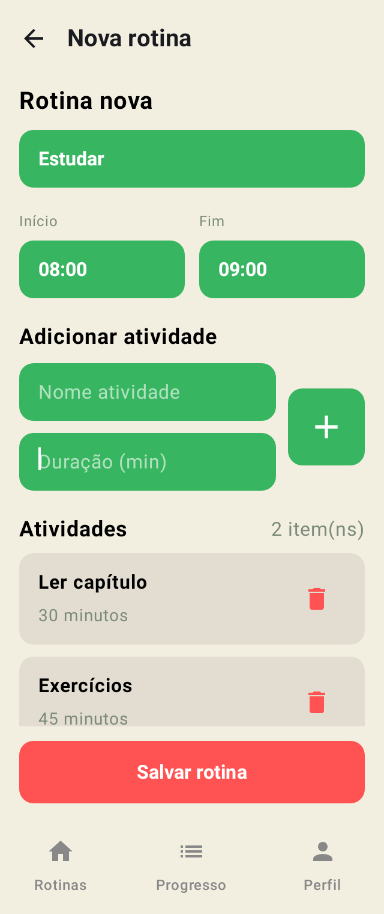
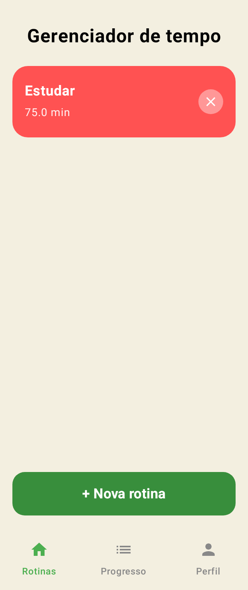
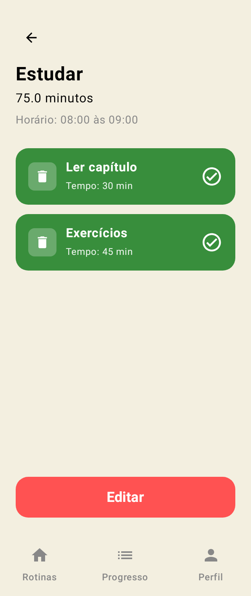
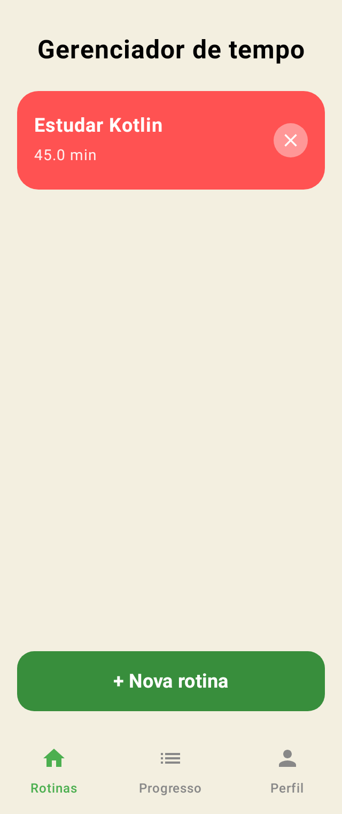
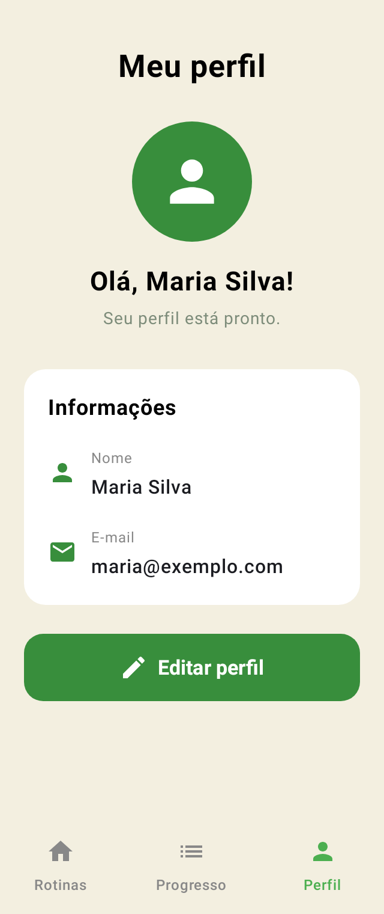
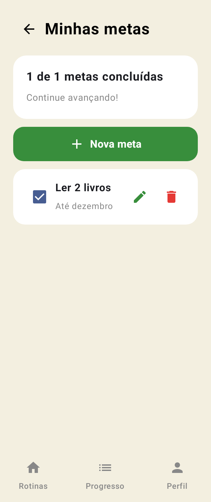
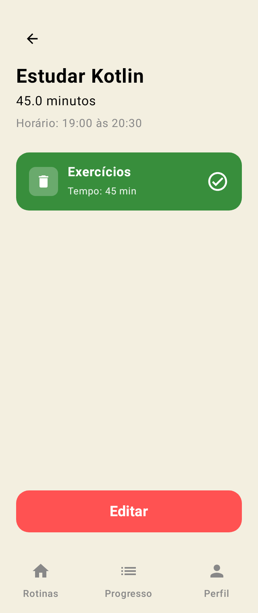

# 🌱 RotinApp — Trabalho 3: Room (documentação)

[⬅ Voltar ao README](../README.md)

## 📝 Documentação do Trabalho 3

## 1. Como estava o projeto no Trabalho 2, e o que mudou para chegar até aqui?

**Como estava:** o app já tinha as telas, a navegação, as listas e os formulários. Mas os dados ficavam só na memória, em listas `mutableStateListOf`. Quando o app era fechado, tudo sumia.

**O que mudou:**

* Adicionei o **Room** ao projeto (banco de dados local).
* As `data class` do Trabalho 2 viraram tabelas do banco (`@Entity`).
* Todas as telas passaram a **buscar e salvar os dados no banco**, e não mais nas listas da memória.
* Criei a **edição de metas** (botão ✏️ no card da meta).
* A tela de **Detalhes da rotina** agora recebe só o **id** e busca a rotina no banco.
* Os horários de **início e fim** da rotina e o **perfil** também passaram a ser salvos.

---

## 2. Quais Entity, DAO e Database foram criados — e por que escolheram esses campos para cada Entity?

**Entities (tabelas):**

| Entity | Campos | Por quê |
|---|---|---|
| `Rotina` | id, nome, tempo total, hora de início, hora de fim | são as informações que aparecem na lista e no formulário de rotina |
| `Atividade` | id, id da rotina, nome, duração | cada atividade pertence a uma rotina; a duração soma no tempo total e no XP |
| `Meta` | id, nome, descrição, concluída | são os dados da tela de metas, incluindo o checkbox de concluída |
| `Perfil` | id, nome, e-mail | são os dados da tela de cadastro |

Em todas, o `id` é criado automaticamente pelo banco (`@PrimaryKey(autoGenerate = true)`).

**DAOs:** um para cada tabela (`RotinaDAO`, `AtividadeDAO`, `MetaDAO`, `PerfilDAO`). Todos têm os 4 métodos básicos: **inserir**, **buscar todos**, **atualizar** e **deletar**.

**Database:** o `AppDatabase` junta as 4 tabelas. Ele segue o padrão **Singleton** visto em aula, ou seja, o app usa sempre a mesma instância do banco.

**Arquivos `_Impl`:** quando o projeto compila, o Room cria sozinho (pelo KSP) os arquivos `AppDatabase_Impl`, `RotinaDAO_Impl`, `AtividadeDAO_Impl`, `MetaDAO_Impl` e `PerfilDAO_Impl`. Eles têm o código que de fato conversa com o banco. Aparecem na pasta **java (generated)** (`app/build/generated/ksp/...`), são recriados a cada build, não precisam ser editados e não vão para o GitHub (a pasta `build` está no `.gitignore`).

---

## 3. Como decidiram estruturar as queries do DAO (quais métodos além dos 4 básicos, se houver)?

Além dos 4 básicos, criei só os métodos que as telas precisavam:

* **`buscarPorId`** (rotinas): a tela de Detalhes recebe o id e busca a rotina certa no banco.
* **`buscarPorRotina`** (atividades): mostra só as atividades da rotina aberta.
* **`deletarPorRotina`** (atividades): quando uma rotina é excluída, as atividades dela são apagadas junto.

Exemplo:

```kotlin
@Query("SELECT * FROM rotinas WHERE id = :id")
suspend fun buscarPorId(id: Int) : Rotina?
```

---

## 4. Qual foi a dificuldade em migrar de `mutableStateListOf` para Room? O que quebrou no caminho e como resolveram?

**Dificuldade:** antes as listas eram globais e mudavam na hora. Com o Room, o banco precisa ser acessado em segundo plano (com Coroutines). Por isso cada tela passou a buscar os seus dados quando abre.

**O que quebrou ou precisou mudar, e como resolvi:**

* **Ao apagar as listas antigas, várias telas pararam de compilar.** → Cada tela passou a buscar os dados no banco com `LaunchedEffect`.
* **O id passou a ser criado pelo banco.** → A rotina nova devolve o id gerado, e as atividades são salvas com esse id.
* **Toast e troca de tela não podem rodar em segundo plano.** → Depois de salvar, eles rodam na thread principal (`withContext(Dispatchers.Main)`).
* **Excluir uma rotina deixaria as atividades dela no banco.** → Criei o `deletarPorRotina`.

---

## 5. Print ou vídeo mostrando o teste de persistência: adicionar um item, fechar o app, reabrir, e o item continuar lá

**🎬 Vídeo:** [assistir no YouTube](https://youtu.be/iRxCBf9muUg)

[](https://youtu.be/iRxCBf9muUg)

**🖼️ Prints:**

> Os prints foram gerados por um teste automático que roda o app de verdade num Android simulado no computador.

**1. Adicionando uma rotina:**

<p>
  
  
  
</p>

**2. Antes de fechar o app:**

<p>
  
  
  
</p>

**3. Depois de fechar e abrir de novo (os dados continuam lá ✅):**

<p>
  
  
  
  
</p>

---

## 6. Algum integrante do trio teve dificuldade em algum ponto? Como resolveram?

Não se aplica: o trabalho foi feito **individualmente**.

---

